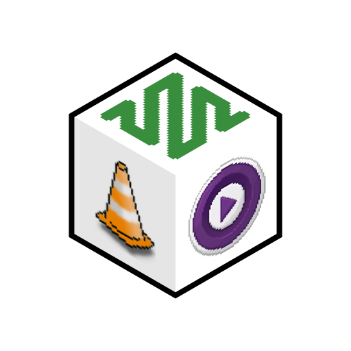

# VideoPlayer

<p align="center">
  
</p>

<p align="center">
  <a href="https://github.com/squi2rel/VideoPlayer/actions/workflows/build.yml"></a>
  <a href="https://www.minecraft.net/"></a>
  <a href="https://adoptium.net/"></a>
  <a href="LICENSE"></a>
</p>

VideoPlayer 支持 Minecraft 1.21.1 NeoForge，以及 1.21.11 和 26.2 Fabric，配套提供 Paper/Folia 服务端桥接插件。客户端负责解码与渲染，服务端负责区域、屏幕、权限、持久化和玩家间同步；多人服务器中的观看者需要安装相同兼容版本的客户端模组。

## 特性

- VLC 与 MPV 双播放后端，启动向导可检测、安装运行库并配置下载代理。
- 客户端音量会在重连和重启游戏后恢复：MPV 按服务器及屏幕保存，VLC 使用全局音量设置。
- 支持直链和网络流，以及哔哩哔哩视频/直播、YouTube、网易云音乐和 MV等来源。
- 支持播放队列、空闲时播放、客户端同步、跳过投票、弹幕、字幕、音频通道和。
- 支持自由顶点屏幕、UV 裁切、缩放、360 球面和可选 Vivecraft VR 集成。
- Paper/Folia 服务端桥接支持Luckperms权限节点和 Residence 区域控制。
- 曲面屏沿用既有 `FLAT` 曲面：以闭合的非共面顶点条带表达，兼容客户端可直接渲染和交互。

## 环境要求

| 组件 | 要求 |
| --- | --- |
| NeoForge 客户端 / 服务端模组 | Minecraft 1.21.1、NeoForge 21.1（构建验证版本 21.1.259）、Java 21 |
| Fabric 客户端 / 服务端模组 | Minecraft 1.21.11/26.2、Fabric Loader、Fabric API、Java 21/25 |
| 服务端桥接 | Paper/folia 1.21.11/26.2、Java 21/25 |

运行库下载源覆盖 Windows、Linux、macOS 和 Android 的常见架构。MPV 与 VLC 的实际可用性取决于所选平台和本机运行库；可通过启动向导安装或改用已有运行库。

## 安装

1. 从 GitHub Release 或 [Actions 构建产物](https://github.com/squi2rel/VideoPlayer/actions) 获取对应 JAR。
2. 将对应加载器的模组 JAR 放入每位观看者的 `mods` 目录。NeoForge 1.21.1 版只需 NeoForge；Fabric 版还需匹配的 Fabric API。
3. NeoForge 1.21.1 多人服务器将同一个 NeoForge JAR 放入服务端 `mods` 目录。Paper/Folia 服务器使用相应版本的插件 JAR，放入 `plugins` 目录后重启。服务端组件不能单独让原版客户端播放视频。
4. 进入游戏后执行 `/videoplayer boot`，选择 VLC 或 MPV，并按向导完成运行库，可选 `yt-dlp` 配置。
5. 使用客户端的创建、管理界面或命令建立区域和屏幕，再将可播放 URL 加入屏幕队列。

请只播放拥有授权或允许公开播放的内容，并遵守视频源及其所在地区的服务条款。

## 常用命令

以下是客户端命令；`/vlc` 或 `/videoplayer` 

| 命令 | 用途 |
| --- | --- |
| `/videoplayer help` | 查看客户端命令及子命令说明 |
| `/videoplayer boot` | 打开设置向导 |
| `/videoplayer backend <backend>` | 查看或切换新播放任务使用的后端；`backend` 为 `vlc` 或 `mpv` |
| `/videoplayer play <url>` | 向当前选中的屏幕请求播放 |
| `/videoplayer biliAuth` | 打开或管理哔哩哔哩认证 |
| `/videoplayer youtubeAuth` | 打开或管理 YouTube Cookie 认证 |

Paper 插件提供的管理命令如下：

| 命令 | 所需权限 | 用途 |
| --- | --- | --- |
| `/videoplayer:vlc joinmessage` | `videoplayer.joinmessage` | 切换客户端版本加入提示 |
| `/vlcversion` | `videoplayer.version` | 查看已连接客户端的 VideoPlayer 版本 |

完整的权限节点见 [plugin.yml](paper-plugin/src/main/resources/plugin.yml)。`videoplayer.admin` 默认授予 OP，并包含服务端管理权限；在 Residence 区域中，创建与编辑操作还会遵循区域所有者和 `padd` 控制。

## 曲面屏顶点约定

曲面屏不使用新的服务端类型。将屏幕表面保留为 `FLAT`，并按以下顺序提交闭合条带顶点：

1. 上边沿弧线从左到右。
2. 下边沿弧线从右到左返回。

顶点总数最多为 64，建议弧角小于 180 度。服务端会沿用现有创建、更新、校验、广播和世界持久化路径，保持顶点顺序及显示配置；兼容客户端会按弧长展开 UV、三角化并参与射线命中。

## 构建

项目使用 Gradle Wrapper：

单独构建 NeoForge 1.21.1（Java 21）并运行其测试：

```bash
./gradlew :neoforge-1.21.1:build
```

构建全部版本需要 Java 25；Gradle 会自动获取其他模块所需的 Java 21 工具链：

```powershell
.\gradlew.bat build
.\gradlew.bat test
.\gradlew.bat :paper-plugin:test
```

构建产物：

| 模块 | 产物路径 |
| --- | --- |
| 1.21.1 NeoForge 模组 | `neoforge-1.21.1/build/libs/VideoPlayer-NeoForge-1.21.1-<版本>.jar` |
| 1.21.11Fabric 客户端模组 | `build/libs/VideoPlayer-Fabric-1.21.11.jar` |
| 1.21.11Paper/Folia 服务端插件 | `paper-plugin/build/libs/VideoPlayer-Paper-1.21.11.jar` |
| 26.2Fabric 客户端模组 | `build/libs/VideoPlayer-Fabric-26.2.jar` |
| 26.2Paper/Folia 服务端插件 | `paper-plugin/build/libs/VideoPlayer-Paper-26.2.jar` |

GitHub Actions 会在每次推送后使用 Java 25 执行构建，并上传这五个产物。

## 开源协议与作者

本项目以 [GPL-3.0](LICENSE) 发布。

作者：squi2rel
协作者： cloudfl4re
